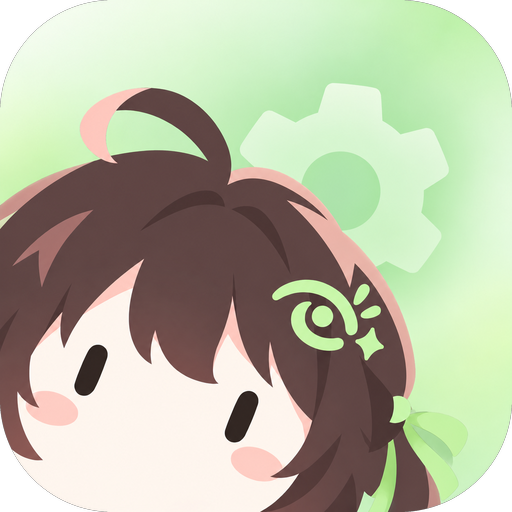
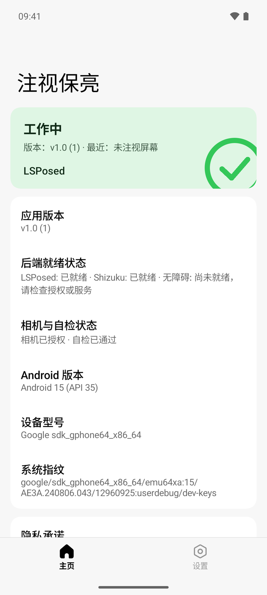
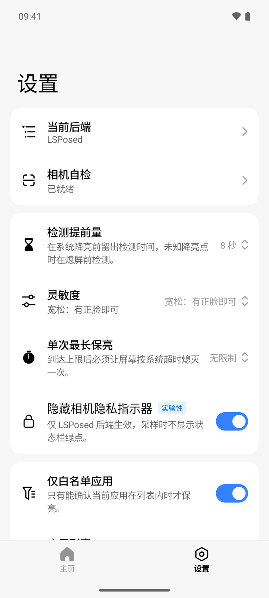
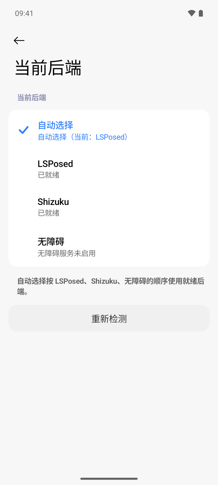
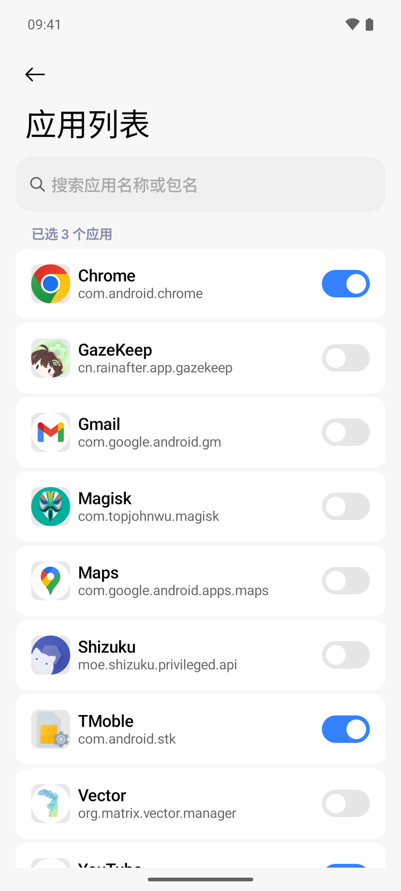

<div align="center">
  

# GazeKeep 注视保亮

[](https://github.com/IceTeacher/GazeKeep)
[](https://github.com/IceTeacher/GazeKeep/releases)
[](https://gazekeep.rainafter.cn)
[](LICENSE)
[](README_en.md)

[🌐 官方网站](https://gazekeep.rainafter.cn) &nbsp;|&nbsp; [📥 下载最新 APK](https://github.com/IceTeacher/GazeKeep/releases/latest) &nbsp;|&nbsp; [💬 问题反馈](https://github.com/IceTeacher/GazeKeep/issues/24) &nbsp;|&nbsp; [📖 English README](README_en.md)

</div>

你有没有遇到过这样的痛点：看长文、查资料或者照着菜谱做饭时，手上有水不方便碰手机，屏幕却动不动就变暗甚至直接熄灭？
为了不被打断，你可能去系统设置里把自动熄屏时间调到了 10 分钟甚至更长。但这又带来了新问题——如果你晚上躺在床上看手机不小心睡着了，屏幕就会这样亮一整宿，不仅费电、发热，OLED 屏幕长期常亮还有烧屏隐患。

「短超时太烦人，长超时怕睡着」，GazeKeep 就是为了解决这个矛盾而诞生的。

它的设计初衷很简单：**为了给没有提供系统级注视保亮功能的 Android 设备，补齐安全、无感且可媲美系统原生体验的注视保亮功能，让旧设备也能更省心、更好地被使用。**

有了 GazeKeep，你可以放心地将系统自动熄屏时间缩短至 15 秒或 30 秒。在你专注阅读屏幕时，它仅在快要熄屏前短暂调用前置摄像头看一眼，只要你仍在注视，就默默为你延长亮屏；一旦你移开视线、或者不小心睡着了没看着屏幕，它绝不瞎干预，让系统像往常一样准时熄灭。

## 为什么要做这个项目

近年来部分厂商的新旗舰已经在系统层集成了注视检测，例如华为的「智感不熄屏」、荣耀的「注视屏幕不熄屏」：平时不占用摄像头，只在熄屏倒计时的最后阶段采样几帧，确认用户在看就重置计时。

但大量仍然好用的老设备、千元机、备用平板，以及刷入 AOSP、LineageOS 等第三方 ROM 的设备，不会再得到厂商的这类适配。GazeKeep 借鉴同样的思路，在 App 层用端上检测加上三种系统联动方式，把这项能力补到这些设备上。

## 设计边界

- **设备要求**：Android 8.0（API 26）及以上，且有可正常使用的前置摄像头。8.0 只是可安装下限，实际表现取决于系统版本、ROM 的电源管理与所选后端，需按设备实测。
- **适用场景**：长文阅读、背单词、对照代码或文档、厨房看菜谱等「盯着看、很少触摸」的场景。
- **不做的事**：不做人脸注册与身份识别，不关心你是谁；不追踪视线落在屏幕的哪个位置，也不做眼控滚动；不持续录像；不申请网络权限，不依赖任何云端服务。
- **判定原则**：看不清就正常熄屏，绝不盲目常亮。暗光、侧脸、闭眼、视线离开、画面里有多人、前置相机被占用，都会让系统按原计划熄屏。

## 核心特性与体验

- **按需短时采样，无感低打扰**：平时绝不常驻占用摄像头，仅在临近系统降亮或熄屏前短暂采样 1 ～ 3 帧，看一眼就立刻关闭。检测与推理全程在端上离线完成；成功帮忙保亮时安静无感、没有任何弹窗，只在服务异常或后端掉线时才会发通知提醒你。
- **绝不盲目常亮**：遇到暗光、侧脸、看不清（「这次没看清」）、画面中出现多人，或摄像头正被系统相机、扫码应用占用时，它会果断放行，让系统正常熄屏。不仅如此，它还内置了单次最长保亮保护（默认 30 分钟，支持自定义或设为无限制），达到上限时释放保亮能力，目标是强制熄屏一次。
- **省电的门控设计**：开相机之前先做一轮不耗电的检查——息屏、锁屏、不在生效范围、通话中、相机被占用时直接跳过；这些都通过后，才短暂读取接近、光照和加速度传感器，识别口袋、倒扣和持续暗光。传感器读完即关，亮屏期间不常驻监听。
- **三种后端适配不同旧设备条件**：考虑到大家的设备条件和折腾程度不同，提供 **LSPosed**（系统框架级联动）、**Shizuku**（ADB / 无线调试授权，免 Root）和 **无障碍服务**（零门槛开箱即用）三种工作后端，支持自动按优先级优选或手动锁定。
- **白名单 / 黑名单生效范围与可视化自检**：默认仅对白名单应用生效，你可以只勾选需要的阅读或浏览类 App，不在全局盲目触发；也可以改为「排除黑名单应用」，只排除视频、相机、导航等无需保亮的 App。内置两步式相机自检向导，搭配克制、清晰的设置界面，支持自由调节检测提前量、灵敏度，以及按需开启本地诊断日志。

## 界面预览

> 💡 建议前往本应用的[官方网站](https://gazekeep.rainafter.cn)，进行高保真、可交互的界面预览和功能体验。

|                                         主页状态                                          |                                        参数设置                                        |
| :---------------------------------------------------------------------------------------: | :------------------------------------------------------------------------------------: |
|     |  |
|                                       **工作后端**                                        |                                      **应用列表**                                      |
|  |  |

## 下载与安装

前往 [GitHub Releases](https://github.com/IceTeacher/GazeKeep/releases/latest) 下载最新发布的正式签名安装包：

| 安装包架构              | 适用设备说明                       | 包体特点                                       |
| :---------------------- | :--------------------------------- | :--------------------------------------------- |
| **`arm64-v8a`**（推荐） | 绝大多数现代主流 Android 手机/平板 | 针对 64 位架构深度优化，单包体积仅约 10~11 MB  |
| **`armeabi-v7a`**       | 早期老旧 32 位 Android 设备        | 兼顾老旧机型兼容性，体积约 10 MB               |
| **`x86_64`**            | PC Android 模拟器                  | 适用于模拟器体验与开发调试                     |
| **`universal`**         | 全架构通用安装包                   | 内置所有原生架构库，约 17 MB，不确定架构时首选 |

各安装包共用同一版本号，可以互相覆盖安装。

## 快速上手

### 四步启用

1. **安装并授权**：安装对应架构的 APK，授予前置相机权限；Android 13 及以上建议同时允许通知，后端掉线或服务异常时才能收到提醒。
2. **两步相机自检**：在应用内进入「相机自检」，正视屏幕通过第一步（识别为「注视了屏幕」），侧头或移开视线通过第二步（识别为「未注视屏幕」）。「这次没看清」不算通过。
3. **配置生效范围**：保持默认的「仅白名单应用」并勾选需要注视保亮的阅读、浏览或烹饪类 App；或改为「排除黑名单应用」，勾选不需要保亮的 App。两份名单分开保存，切换不会互相覆盖。
4. **确认后端并开启**：在首页确认至少一个后端已就绪，打开「注视保亮」总开关；再把系统自动熄屏时间设为 15 秒或 30 秒，就可以体验注视时不熄屏了。

### 后台保活与常见坑

GazeKeep 依赖常驻服务在熄屏倒计时阶段准时唤醒，被系统冻结或杀掉后就会失效：

- **小米 / HyperOS**：默认的「智能」省电策略会在你用过一次系统相机后冻结 GazeKeep，退出相机后也不会解冻，忽略电池优化同样无效。请在 GazeKeep 设置页「后台运行」或系统应用设置中把省电策略改为「无限制」；修改时系统会强制关闭一次 App，改完重新打开即可（Xiaomi 12 Pro / HyperOS 2 实测）。
- **其他 ROM**：通常需要在多任务界面锁定 GazeKeep，并在系统设置里允许自启动、后台运行，具体入口因机型而异（尚未逐一实测）。
- **无障碍开关是灰色的**：Android 13 起，不是从应用商店安装的 APK 需要先在系统「应用信息」页右上角菜单里「允许受限制的设置」，再回到无障碍设置开启。

更多排查见[使用说明](docs/product/usage.md)。

## 三种工作后端

GazeKeep 的检测与决策都在 App 进程里完成，后端只负责两件事：告诉 App「系统什么时候要降亮 / 熄屏、当前前台是哪个应用」，以及在确认注视后把这次熄屏推迟。

| 后端        | 门槛                                   | 如何延长亮屏                                                                            | 前台应用识别                | 特点                                           |
| :---------- | :------------------------------------- | :-------------------------------------------------------------------------------------- | :-------------------------- | :--------------------------------------------- |
| **LSPosed** | 已 Root 并安装 LSPosed 框架            | 模块注入 `system_server`，由系统电源服务直接记一次用户活动                              | 系统内查询                  | 最贴近原生，时序最准；可选隐藏采样时的相机绿点 |
| **Shizuku** | 免 Root，需 ADB 或无线调试启动 Shizuku | 以 shell 身份调用系统电源服务记录用户活动；不被允许时临时调大熄屏时间，并在之后恢复原值 | shell 查询当前 resumed 页面 | 不用解锁 Bootloader，比无障碍更稳定            |
| **无障碍**  | 零门槛，在系统设置开启即可             | 确认注视后挂一个不可见的无障碍窗口保持亮屏，离开、看不清或到达上限时撤下                | 无障碍窗口切换事件          | 人人可用，适合长辈的阅读设备和旧平板           |

- **LSPosed**：在 LSPosed 管理器中启用模块，作用域选择「系统框架」，重启后回到 App 确认就绪。更新模块后同样需要重启。设置里的「隐藏相机隐私指示器」是默认关闭的实验功能，只在系统内过滤 GazeKeep 自己的相机活跃提示，不改动其他应用。
- **Shizuku**：用 Android 11 及以上的「无线调试」或电脑 ADB 启动 [Shizuku](https://shizuku.rikka.app/)，再在 GazeKeep 中授权。手机重启后需要按 Shizuku 的方式重新启动服务。
- **无障碍**：在系统「设置 → 无障碍」中开启 GazeKeep。服务声明了 `canRetrieveWindowContent="false"`，从系统层面就无法读取屏幕上的文字、输入框或界面节点，只接收窗口切换和触摸开始这类事件。

后端默认采用 **Auto（自动）** 模式，按 `LSPosed → Shizuku → 无障碍` 的顺序选用第一个已就绪的后端；也可以在设置里手动锁定某一个。锁定的后端失效时会发通知提醒，不会静默切换到其他后端。

## 工作原理

GazeKeep 不常开相机，而是跟着系统的熄屏倒计时走：

```text
最后一次触摸
  └─ 后端报告：系统将在何时降亮 / 熄屏
       └─ 在「降亮前 提前量」处醒来（不知道降亮时间时，按熄屏时间计算）
            ├─ 门控检查：息屏、锁屏、生效范围、相机类应用、通话、相机被占用 ── 任一命中 → 放行
            ├─ 短暂读取传感器：口袋（接近）、倒扣（加速度）、持续暗光（光照） ── 命中 → 放行
            └─ 打开前置相机，采样 1～3 帧
                 ├─ 2 帧判定为注视 → 推迟这次熄屏，等待下一轮倒计时
                 └─ 未注视 / 看不清 / 出错 → 什么都不做，系统按原计划熄屏
```

### 一帧画面是怎么判断的

1. **暗光快速拦截**：相机输出 640×480 的画面后，先每隔 8 个像素抽样计算亮度平均值，低于 25 直接判为太暗，不再调用模型，省下一次推理。
2. **人脸检测**：亮度足够时交给 Google ML Kit 的离线人脸检测（随 APK 内置，不联网），读取人脸数量、大小、头部转角和睁眼概率。
3. **逐项判定**：没有人脸 → 未注视；多于一张脸 → 未注视（防止旁人路过时误常亮）；脸太小（宽度不足画面 18%）→ 未注视（防止远处充电的手机被模糊人影点亮）；左右转头或抬头低头超过 25° → 未注视；「标准」灵敏度还要求双眼睁开概率都不低于 0.6，「宽松」灵敏度跳过睁眼检查。
4. **投票**：最多采样 3 帧，帧间隔 150 ms，需要 2 帧一致才下结论；一旦结论已定就提前结束并立即释放相机。

### 低功耗的几个细节

- 连续两次确认注视后，下一轮会把提前量缩短 3 秒（最少 4 秒）、最多只采 2 帧，持续阅读时开相机的时间更短。
- 连续两次因为太暗没看清、且环境光低于 3 lux 时，后续检测直接跳过、不开相机；环境变亮后自动恢复。
- 传感器只在其他门控都通过后打开约 1 秒内的读取窗口，读到即关；息屏时立即注销。
- Shizuku 后端息屏时暂停读取系统电源状态，其他应用自己保持亮屏（例如播放视频）时降低读取频率。
- 在 Xiaomi 12 Pro 上实测，从开始采样到拿到第一帧约 0.4 秒，整次采样约 0.6～0.9 秒。

## 参数调优建议

| 设置项       | 默认值       | 建议                                                                            |
| :----------- | :----------- | :------------------------------------------------------------------------------ |
| 检测提前量   | 8 秒         | 可选 5 秒、8 秒或自定义 0～60 秒。相机启动慢、系统降亮过程很短的机型，适当调大  |
| 灵敏度       | 标准         | 「标准」要求正脸且睁眼；戴反光眼镜、睁眼识别不稳时可改「宽松」，只要求正脸      |
| 单次最长保亮 | 30 分钟      | 建议保留，作为睡着、忘关等极端情况下的兜底；可自定义或设为无限制                |
| 生效范围     | 仅白名单应用 | 只在需要的 App 里检测，最省电；需要全局使用时选「全部应用」，相机类应用仍会跳过 |
| 详细日志     | 关闭         | 排查问题时再打开；开启后只保留最近 24 小时，关闭即清除                          |

## 隐私与安全

1. 只在快要熄屏时打开前置摄像头，看完立刻关闭。
2. 画面只在内存里判断是否注视了屏幕，不保存、不上传。
3. 看不清、没看清、旁边有别人，都会让屏幕正常熄灭。

- **没有联网能力**：申请的系统权限只有相机、前台服务（含相机类型）、通知和开机启动，另有 Shizuku 授权所需的权限；打包时显式移除 `INTERNET` 与 `ACCESS_NETWORK_STATE`，即使某个依赖库声明了网络权限也会被剔除。
- **不碰你的文件与隐私数据**：不申请存储/相册、读取应用列表（`QUERY_ALL_PACKAGES`）或悬浮窗权限；采样帧只在内存中判断，用完即释放，不写任何文件或缓存。
- **零第三方 SDK**：不接入任何统计、广告或崩溃上报 SDK。
- **唯一的预览**：相机画面只出现在你主动打开的自检向导页，离开页面立即释放。
- **日志只记结果**：诊断日志默认关闭，只记录时间、前台应用包名、判定结果、跳过原因、后端与耗时，不记录图像、人脸位置、角度或概率。

完整边界见[隐私与安全](docs/product/privacy-security.md)。

## 项目结构与技术栈

| 目录 / 模块          | 职责                                                           |
| :------------------- | :------------------------------------------------------------- |
| `apps/app/android`   | 应用入口、常驻服务、通知与各模块装配                           |
| `apps/app/shared`    | Compose Multiplatform + miuix 界面，同时供官网的交互演示复用   |
| `apps/app/core`      | 纯 Kotlin 决策核心：状态机、门控与判定规则                     |
| `apps/app/engine`    | CameraX 采集、ML Kit 分类、传感器与相机可用性门控              |
| `apps/app/backend/*` | 无障碍、Shizuku、LSPosed 三种后端                              |
| `apps/app/xposed`    | 运行在 `system_server` 中的 LSPosed 钩子，只报告时序并执行保亮 |
| `apps/web`           | 基于 Astro、Tailwind CSS 与 Three.js 的中英双语官网            |
| `scripts/repo-tools` | 文档、提交与发布相关的仓库工具                                 |

主要依赖：Kotlin、Compose Multiplatform、[miuix](https://github.com/compose-miuix-ui/miuix)、AndroidX CameraX、[ML Kit Face Detection](https://developers.google.com/ml-kit/vision/face-detection)、[Shizuku API](https://github.com/RikkaApps/Shizuku-API)、[libxposed API](https://github.com/libxposed/api)。架构说明见[架构总览](docs/architecture/overview.md)。

## 当前状态

- 端上检测、三种后端、门控、界面、参数配置与两步自检均已实现，正式签名安装包通过 [GitHub Releases](https://github.com/IceTeacher/GazeKeep/releases) 发布。
- 实机验证目前以 Xiaomi 12 Pro（HyperOS 2 / Android 14）为主，其他 ROM 与 Android 版本上的相机、传感器、后台限制和权限异常仍待补测；已知缺口与验收记录见[任务清单](docs/plans/todo.md)。

## 问题反馈与参与开发

- **遇到问题**：欢迎到[置顶的反馈帖](https://github.com/IceTeacher/GazeKeep/issues/24)按模板反馈，不需要懂技术；App 首页隐私卡片下方和「设置 → 关于」里的「问题反馈」也能直接打开。
- **从源码构建**：可构建 Debug APK（产物位于 `apps/app/android/build/outputs/apk/debug/`）：

```bash
pnpm --filter @gazekeep/app exec ./gradlew :android:assembleDebug
```

- **文档**：完整构建与工具链要求见[开发与贡献](docs/development/contributing.md)，测试与验收矩阵见[测试与验收](docs/development/testing.md)，全部文档导航见[文档导航](docs/index.md)。
- **延伸阅读**：[为你的 Android 设备补齐注视保亮功能 —— GazeKeep 使用指南与原理解析](https://www.rainafter.cn/posts/%E4%B8%BA%E4%BD%A0%E7%9A%84-android-%E8%AE%BE%E5%A4%87%E8%A1%A5%E9%BD%90%E6%B3%A8%E8%A7%86%E4%BF%9D%E4%BA%AE%E5%8A%9F%E8%83%BD--gazekeep-%E4%BD%BF%E7%94%A8%E6%8C%87%E5%8D%97/)。

## 开源协议

本项目采用 [MIT 许可](LICENSE) 开源（内置第三方运行依赖声明见应用“关于”页或 `THIRD_PARTY_NOTICES.txt`）。
