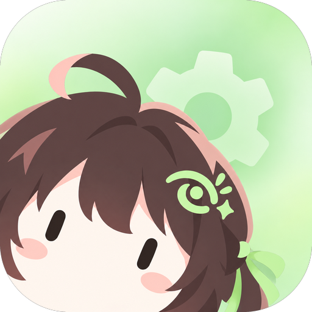
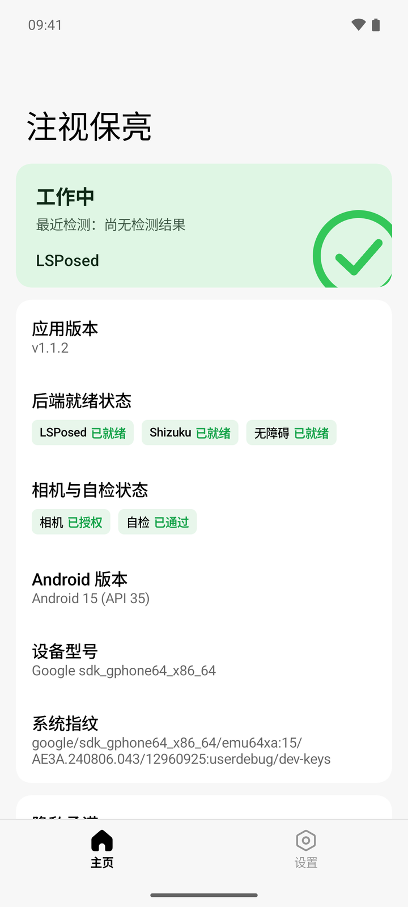
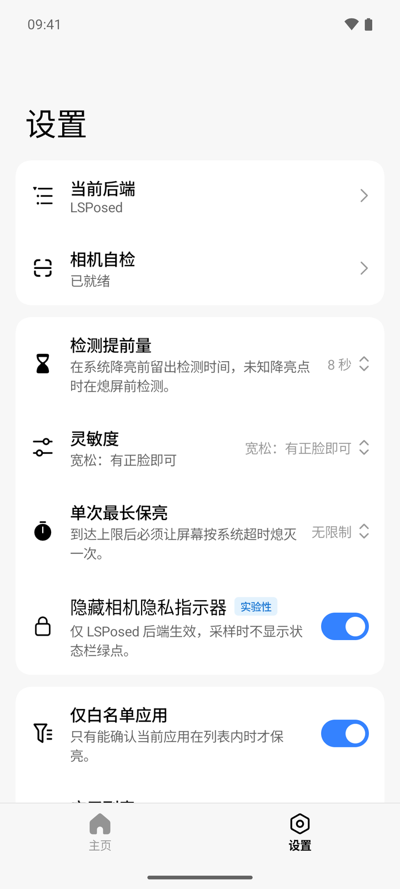
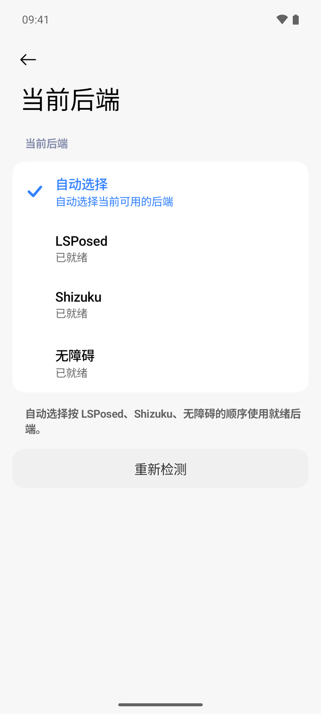
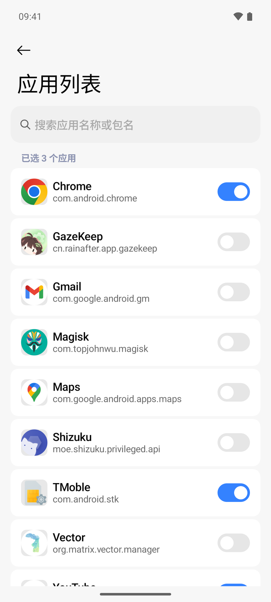

<div align="center">
  

# GazeKeep

[](https://github.com/IceTeacher/GazeKeep)
[](https://github.com/IceTeacher/GazeKeep/releases)
[](https://gazekeep.rainafter.cn)
[](LICENSE)
[](README.md)

[🌐 Official Website](https://gazekeep.rainafter.cn) &nbsp;|&nbsp; [📥 Download Latest APK](https://github.com/IceTeacher/GazeKeep/releases/latest) &nbsp;|&nbsp; [📖 简体中文](README.md)

</div>

Have you ever encountered this frustrating dilemma: reading long articles, researching notes, or following a recipe while cooking with wet hands, only for the screen to dim or turn off right when you need it?
To prevent unwanted screen-offs, you might set the system display timeout to 10 minutes or even longer. But that brings a new problem—if you doze off while reading in bed, your screen stays awake all night, draining battery and risking screen burn-in.

"Short timeouts cause frequent interruptions, while long timeouts risk sleeping with the screen on." GazeKeep was created specifically to eliminate this trade-off.

Its design philosophy is simple: **Bring a secure, seamless, and native-grade screen-attention experience to Android devices that lack built-in gaze detection, breathing new life into older hardware.**

With GazeKeep, you can confidently lower your system display timeout to an ultra-short 15 or 30 seconds. While you are actively looking at the screen, GazeKeep briefly checks via the front camera right before timeout. As long as you are looking, it quietly extends screen-on time. If you look away or fall asleep, it never interferes, allowing your device to sleep promptly on schedule.

## Core Features & Experience

- **Brief On-Demand Checks, Zero Distraction**: The front camera is never kept continuously active in the background. It samples only 1–3 frames right before system dimming or screen timeout, releasing hardware immediately upon decision. Inference and facial landmark checks run 100% offline on-device. Normal keep-awake operation is completely silent with no popups; notifications appear only upon service error or backend disconnection.
- **Never Stay Awake Blindly**: Under low-light conditions, sharp side angles, motion blur ("unclear detection"), multiple faces, or when the camera is occupied by system camera or barcode scanning apps, GazeKeep decisively yields control to let the screen sleep normally. Furthermore, it features a built-in single-session maximum keep-awake limit (default 30 minutes, customizable or can be set to unlimited), releasing keep-awake capability once the limit is reached to force a screen-off.
- **Three Backends for Diverse Device Environments**: Tailored for varying device conditions and setups, GazeKeep offers three operational backends: **LSPosed** (system framework-level integration), **Shizuku** (non-root ADB / wireless debugging authorization), and **Accessibility Service** (zero-barrier, out-of-the-box). It supports automatic priority-based selection or manual pinning.
- **App Whitelist & Interactive Self-Test**: Enabled by default, whitelist filtering ensures keep-awake only triggers when selected reading or browsing apps are in the foreground, avoiding global indiscriminate activation. It includes an interactive 2-step camera self-test wizard, a clean and restrained settings UI, adjustable lead time and sensitivity, and optional local diagnostic logging.

## Screenshots

|                                                 Home Status                                                  |                                                Settings                                                 |
| :----------------------------------------------------------------------------------------------------------: | :-----------------------------------------------------------------------------------------------------: |
|          |  |
|                                                 **Backends**                                                 |                                            **App Whitelist**                                            |
|  |                 |

## Privacy & Security

1. The front camera opens only near screen timeout and closes immediately after checking.
2. Frames are processed in memory to check whether you are looking at the screen. Nothing is saved or uploaded.
3. Unclear results, failed detection or another person in view let the screen sleep normally.

This app does not request Internet (`INTERNET`), storage/photos, installed package queries (`QUERY_ALL_PACKAGES`), or overlay (`SYSTEM_ALERT_WINDOW`) permissions. It does not integrate any analytics, advertising, or crash reporting SDKs. The accessibility service does not inspect window text content. Camera preview only appears in the user-initiated self-test wizard and releases immediately upon exit. See [Privacy & Security](docs/product/privacy-security.md) for full boundaries.

## Download & Installation

Visit [GitHub Releases](https://github.com/IceTeacher/GazeKeep/releases/latest) to download the latest signed APK:

| Architecture                  | Target Device                        | Package Characteristics                                |
| :---------------------------- | :----------------------------------- | :----------------------------------------------------- |
| **`arm64-v8a`** (Recommended) | Most modern Android phones & tablets | Optimized for 64-bit devices; compact size (~10–11 MB) |
| **`armeabi-v7a`**             | Legacy 32-bit Android devices        | Compatibility package for older devices (~10 MB)       |
| **`x86_64`**                  | PC Android Emulators                 | For emulator testing and development debugging         |
| **`universal`**               | All-architecture universal package   | Bundles all native binaries (~17 MB); choose if unsure |

## Working Modes & Getting Started

### 1. 4-Step Setup Flow

1. **Download, Install & Authorize**: Visit [GitHub Releases](https://github.com/IceTeacher/GazeKeep/releases/latest) to download and install the appropriate APK architecture. Grant camera permission (notification permission is recommended on Android 13+ for error alerts).
2. **2-Step Camera Self-Test**: Navigate to "Camera Self-Test" in the app: look at the screen to pass step 1 (recognized as "Looking at the screen"), then turn your head or look away to pass step 2 (recognized as "Not looking at the screen").
3. **Configure App Whitelist**: Keep app whitelist enabled and select reading, browsing, or cooking apps where gaze-keep should be active.
4. **Confirm Backend & Enable**: Ensure at least one backend is ready, then switch on the master keep-awake toggle on the home page.

### 2. Backend Comparison & Preparation

| Backend           | Applicable Conditions               | Backend Highlights                                                                           |
| :---------------- | :---------------------------------- | :------------------------------------------------------------------------------------------- |
| **LSPosed**       | Rooted with framework               | System framework-level event interception and screen-on control; closest to native feel      |
| **Shizuku**       | Non-root (ADB / Wireless debugging) | Executes system scheduling via ADB / wireless debugging authorization in non-root setups     |
| **Accessibility** | Non-root, zero barrier              | Zero-barrier and works out of the box; maintains screen-on by simulating subtle interactions |

Backends default to **Auto** mode, automatically selecting ready backends in order of `LSPosed → Shizuku → Accessibility`. If a backend is manually locked, it will not silently fall back to other backends on failure. Foreground app identification uses accessibility events, Shizuku shell queries, or LSPosed system queries respectively. See [Usage Guide](docs/product/usage.md) for details and troubleshooting.

## Current Status & Development

- **Compatibility & Progress**: On-device detection, three backends, UI screens, parameter configuration, and 2-step self-test are fully implemented. Android 8.0 (API 26) is the minimum supported version; actual performance depends on system version, ROM power management, and backend capabilities, requiring testing on the target device. Sensor gating is wired. Officially signed APKs are available via GitHub Pre-releases; full physical device regression for the current version remains pending. See [Product Overview](docs/product/overview.md) and [Task List](docs/plans/todo.md) for details.
- **Building from Source**: You can currently build a Debug APK from source (artifacts output to `apps/app/android/build/outputs/apk/debug/`):

```bash
pnpm --filter @gazekeep/app exec ./gradlew :android:assembleDebug
```

- **Documentation**: See [Contributing Guide](docs/development/contributing.md) for full build and toolchain requirements, [Testing & Acceptance](docs/development/testing.md) for test matrices, and [Documentation Navigation](docs/index.md) for all document entries.

## License

This project is licensed under the [MIT License](LICENSE) (third-party runtime notices can be found in the app's "About" page or `THIRD_PARTY_NOTICES.txt`).
