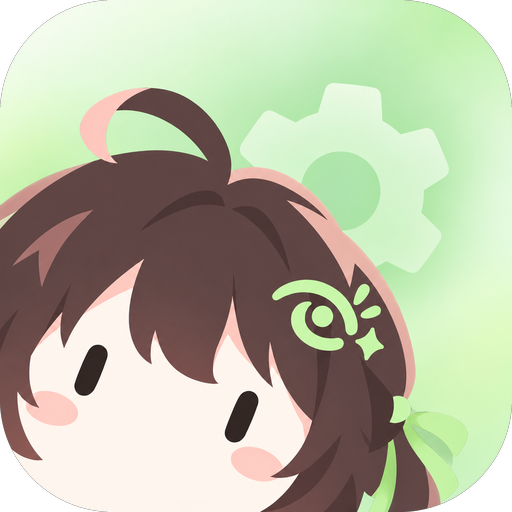
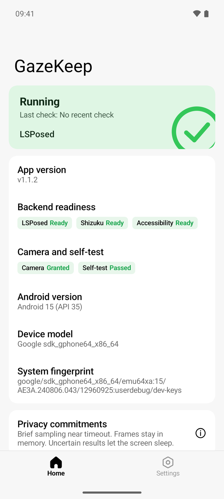
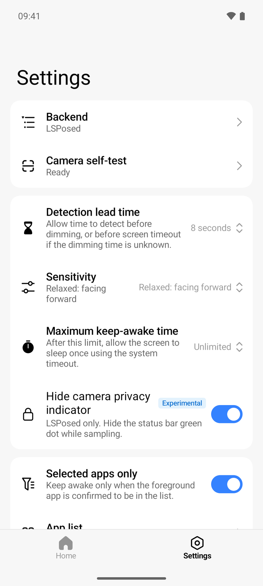
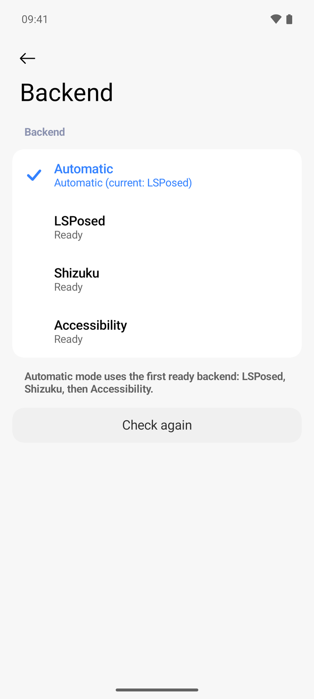
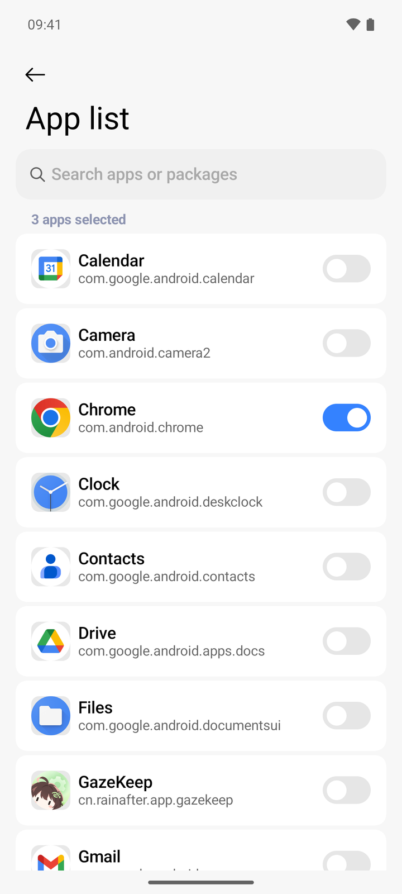

<div align="center">
  

# GazeKeep

[](https://github.com/IceTeacher/GazeKeep)
[](https://github.com/IceTeacher/GazeKeep/releases)
[](https://gazekeep.rainafter.cn)
[](LICENSE)
[](README.md)

[🌐 Official Website](https://gazekeep.rainafter.cn) &nbsp;|&nbsp; [📥 Download Latest APK](https://github.com/IceTeacher/GazeKeep/releases/latest) &nbsp;|&nbsp; [💬 Report a Problem](https://github.com/IceTeacher/GazeKeep/issues/24) &nbsp;|&nbsp; [📖 简体中文](README.md)

</div>

Have you ever run into this: you are reading a long article, looking something up, or following a recipe with wet hands, and the screen dims or turns off right when you need it?
To avoid the interruption, you might raise the system screen timeout to 10 minutes or more. But that creates a new problem—if you doze off reading in bed, the screen stays on all night, wasting battery, heating up the phone, and over time risking burn-in on OLED panels.

"Short timeouts are annoying, long timeouts risk falling asleep with the screen on." GazeKeep was created to resolve exactly this trade-off.

Its goal is simple: **bring a safe, unobtrusive, native-feeling "stay awake while I'm looking" experience to Android devices that lack it at the system level, so older devices stay pleasant to use.**

With GazeKeep you can confidently set the system screen timeout to 15 or 30 seconds. While you are reading, it briefly checks with the front camera right before the screen would turn off. As long as you are still looking, it quietly extends the screen-on time; once you look away or fall asleep, it never interferes, and the screen turns off on schedule as usual.

## Why This Project

In recent years some vendors have built gaze detection into the system on their new flagships, such as the gaze-aware "keep screen on while looking" features on recent Huawei and Honor phones: the camera stays off most of the time, and only a few frames are sampled at the very end of the timeout countdown to reset the timer if you are looking.

Plenty of still-useful older phones, budget phones, spare tablets, and devices running AOSP, LineageOS, or other custom ROMs will never receive such vendor features. GazeKeep borrows the same idea and brings it to these devices at the app level, using on-device detection plus three ways of integrating with the system.

## Design Boundaries

- **Requirements**: Android 8.0 (API 26) or later with a working front camera. 8.0 is only the installation floor; real-world behavior depends on the Android version, the ROM's power management, and the chosen backend, so test on your own device.
- **Best suited for**: long-form reading, vocabulary drills, comparing code or documents, following recipes in the kitchen—anything where you mostly look and rarely touch.
- **What it does not do**: no face enrollment or identity recognition (it does not care who you are); no tracking of where on the screen you are looking and no eye-controlled scrolling; no continuous recording; no network permission and no cloud services.
- **Decision principle**: if it can't see clearly, the screen turns off normally—never stay awake blindly. Low light, a turned head, closed eyes, looking away, more than one person in view, or a front camera in use elsewhere all let the system turn off the screen as planned.

## Core Features & Experience

- **Brief on-demand sampling, unobtrusive**: The front camera is never held in the background. It samples only 1–3 frames right before the system dims or turns off the screen, then closes immediately. Detection runs entirely offline on the device. Successful keep-awake is silent with no popups; you are notified only when the service fails or a backend disconnects.
- **Never stays awake blindly**: In low light, with a turned head, when it could not tell ("Could not tell this time"), with multiple faces in view, or when the camera is in use by the system camera or a barcode scanner, GazeKeep steps aside and lets the screen turn off. It also has a single-session maximum keep-awake time (30 minutes by default, customizable or unlimited); when the limit is reached it releases keep-awake so the screen turns off once.
- **Power-conscious gating**: Before opening the camera it runs a round of cheap checks and skips immediately if the screen is off or locked, the app is out of scope, a call is in progress, or the camera is busy. Only after these pass does it briefly read the proximity, light, and accelerometer sensors to detect a pocket, a face-down phone, or sustained darkness. Sensors are released right after reading instead of being monitored while the screen is on.
- **Three backends for different device setups**: **LSPosed** (system framework integration), **Shizuku** (ADB / wireless debugging authorization, no root), and **Accessibility** (no setup barrier). Backends can be picked automatically by priority or locked manually.
- **Selected / excluded app scope & guided self-test**: By default it only works in apps you select, such as readers and browsers, instead of firing everywhere; or switch to "All except excluded apps" and exclude only video, camera, or navigation apps that do not need it. A two-step camera self-test wizard and a clean settings page let you tune the detection lead time and sensitivity and turn on local diagnostic logs when needed.

## Screenshots

> 💡 For a high-fidelity, interactive preview of the UI and features, visit the [official website](https://gazekeep.rainafter.cn).

|                                                   Home Status                                                   |                                                  Settings                                                  |
| :-------------------------------------------------------------------------------------------------------------: | :--------------------------------------------------------------------------------------------------------: |
|          |  |
|                                                  **Backends**                                                   |                                                **App List**                                                |
|  |      |

## Download & Installation

Visit [GitHub Releases](https://github.com/IceTeacher/GazeKeep/releases/latest) to download the latest signed APK:

| Architecture                  | Target Device                        | Package Characteristics                                |
| :---------------------------- | :----------------------------------- | :----------------------------------------------------- |
| **`arm64-v8a`** (Recommended) | Most modern Android phones & tablets | Optimized for 64-bit devices; compact size (~10–11 MB) |
| **`armeabi-v7a`**             | Legacy 32-bit Android devices        | Compatibility package for older devices (~10 MB)       |
| **`x86_64`**                  | PC Android Emulators                 | For emulator testing and development debugging         |
| **`universal`**               | All-architecture universal package   | Bundles all native binaries (~17 MB); choose if unsure |

All packages share the same version code and can be installed over one another.

## Getting Started

### Four-Step Setup

1. **Install and grant permissions**: Install the APK for your architecture and grant the camera permission. On Android 13 and later, also allow notifications so you are alerted when a backend disconnects or the service fails.
2. **Two-step camera self-test**: Open "Camera self-test" in the app. Look at the screen to pass step 1 ("Looking at the screen"), then turn your head or look away to pass step 2 ("Not looking at the screen"). "Could not tell this time" does not count as a pass.
3. **Configure the app scope**: Keep the default "Selected apps only" and select the reading, browsing, or cooking apps where you want it, or switch to "All except excluded apps" and select apps that should never stay awake. The two lists are stored separately, so switching does not overwrite either one.
4. **Confirm a backend and enable**: On the home page, make sure at least one backend is ready and turn on the main switch. Then set the system screen timeout to 15 or 30 seconds and enjoy a screen that stays on while you look at it.

### Background Survival & Common Pitfalls

GazeKeep relies on a resident service waking up on time during the timeout countdown; if the system freezes or kills it, keep-awake stops working:

- **Xiaomi / HyperOS**: The default "Smart" battery saver freezes GazeKeep after you use the system camera once, and does not unfreeze it after you leave the camera; ignoring battery optimization does not help. Set battery saver to "No restrictions" via "Background activity" in GazeKeep's settings or in the system app settings. The system force-stops the app once when you change it; just reopen GazeKeep afterwards (tested on Xiaomi 12 Pro / HyperOS 2).
- **Other ROMs**: You usually need to lock GazeKeep in the recent-apps screen and allow auto-start and background activity in the system settings; the exact entries vary by device (not yet tested one by one).
- **Accessibility switch is greyed out**: Since Android 13, APKs not installed from an app store must first be granted "Allow restricted settings" from the top-right menu of the system "App info" page before the accessibility service can be turned on.

See the [Usage Guide](docs/product/usage.md) for more troubleshooting.

## Three Working Backends

Detection and decisions all happen in the GazeKeep app process. A backend only does two things: tells the app when the system will dim or turn off the screen and which app is in the foreground, and postpones this screen-off once you are confirmed to be looking.

| Backend           | Requirements                                           | How it extends screen-on time                                                                                                                                | Foreground app detection            | Highlights                                                                      |
| :---------------- | :----------------------------------------------------- | :----------------------------------------------------------------------------------------------------------------------------------------------------------- | :---------------------------------- | :------------------------------------------------------------------------------ |
| **LSPosed**       | Rooted, with the LSPosed framework installed           | The module runs inside `system_server` and records a user activity directly in the system power service                                                      | Queried inside the system           | Closest to native with the most accurate timing; can hide the camera green dot  |
| **Shizuku**       | No root; Shizuku started via ADB or wireless debugging | Records a user activity in the system power service as the shell user; if that is not allowed, temporarily raises the screen timeout and restores it later   | Shell query of the resumed activity | No bootloader unlock needed; more robust than Accessibility                     |
| **Accessibility** | No barrier; just enable it in system settings          | After a confirmed look, attaches an invisible accessibility window that keeps the screen on, and removes it on look-away, unclear results, or the time limit | Accessibility window-change events  | Works for everyone; good for elderly relatives' reading devices and old tablets |

- **LSPosed**: Enable the module in LSPosed Manager, select "System Framework" as the scope, reboot, then confirm it is ready in the app. Reboot again after updating the module. "Hide camera privacy indicator" in Settings is an experimental option, off by default; it only filters GazeKeep's own camera-in-use indication inside the system and does not affect other apps.
- **Shizuku**: Start [Shizuku](https://shizuku.rikka.app/) using "Wireless debugging" on Android 11+ or ADB from a computer, then authorize GazeKeep. After a reboot, restart the Shizuku service the way Shizuku requires.
- **Accessibility**: Turn on GazeKeep under system "Settings → Accessibility". The service declares `canRetrieveWindowContent="false"`, so the system itself prevents it from reading on-screen text, input fields, or UI nodes; it only receives events such as window changes and touch starts.

Backends default to **Auto** mode, using the first ready backend in the order `LSPosed → Shizuku → Accessibility`; you can also lock one manually in Settings. If a locked backend fails, you get a notification and GazeKeep never silently switches to another backend.

## How It Works

GazeKeep does not keep the camera open; it follows the system's screen-off countdown:

```text
Last touch
  └─ Backend reports when the system will dim / turn off the screen
       └─ Wake up at "dim time minus lead time" (screen-off time if the dim time is unknown)
            ├─ Gates: screen off, locked, app scope, camera apps, in call, camera busy ── any hit → let it sleep
            ├─ Brief sensor read: pocket (proximity), face down (accelerometer), sustained darkness (light) ── hit → let it sleep
            └─ Open the front camera and sample 1–3 frames
                 ├─ 2 frames say "looking" → postpone this screen-off and wait for the next countdown
                 └─ Not looking / unclear / error → do nothing; the screen turns off as planned
```

### How a Single Frame Is Judged

1. **Fast low-light rejection**: For each 640×480 frame, the average brightness is first computed by sampling every 8th pixel. Below 25 the frame is judged too dark and the model is not invoked, saving an inference.
2. **Face detection**: With enough light, the frame goes to Google ML Kit's offline face detection (bundled in the APK, no network), which reports the number of faces, face size, head rotation, and eye-open probabilities.
3. **Rule checks**: no face → not looking; more than one face → not looking (so a passer-by does not keep the screen on); face too small (narrower than 18% of the frame) → not looking (so a phone charging across the room is not kept on by a blurry figure); head turned left/right or up/down by more than 25° → not looking; "Standard" sensitivity also requires both eye-open probabilities to be at least 0.6, while "Relaxed" skips the eye check.
4. **Voting**: At most 3 frames are sampled, 150 ms apart, and 2 matching frames are needed for a decision; as soon as a decision is reached, sampling stops and the camera is released.

### Power-Saving Details

- After two consecutive confirmed looks, the next round shortens the lead time by 3 seconds (minimum 4 seconds) and samples at most 2 frames, so the camera is open for less time during sustained reading.
- After two consecutive "too dark to tell" results with ambient light below 3 lux, later checks are skipped without opening the camera; they resume automatically when it gets brighter.
- Sensors are read only in a window of about 1 second after all other gates pass, released as soon as readings arrive, and unregistered immediately when the screen turns off.
- The Shizuku backend stops reading the system power state while the screen is off, and reads less often while another app keeps the screen on by itself (for example, during video playback).
- Measured on a Xiaomi 12 Pro: about 0.4 seconds from the start of sampling to the first frame, and about 0.6–0.9 seconds for a whole sampling round.

## Tuning Recommendations

| Setting                 | Default            | Recommendation                                                                                                                                   |
| :---------------------- | :----------------- | :----------------------------------------------------------------------------------------------------------------------------------------------- |
| Detection lead time     | 8 seconds          | Choose 5 or 8 seconds, or a custom 0–60 seconds. Increase it on devices with a slow camera start or a very short dim phase                       |
| Sensitivity             | Standard           | "Standard" requires facing forward with eyes open; switch to "Relaxed" (facing forward only) if reflective glasses make eye detection unreliable |
| Maximum keep-awake time | 30 minutes         | Keep it as a safety net for falling asleep or forgetting the phone; it can be customized or set to unlimited                                     |
| App scope               | Selected apps only | Detecting only in the apps you need saves the most power; choose "All apps" for global use—camera apps are still skipped                         |
| Detailed logs           | Off                | Turn on only for troubleshooting; when on, only the last 24 hours are kept, and turning it off clears them                                       |

## Privacy & Security

1. The front camera opens only near screen timeout and closes immediately after checking.
2. Frames are processed in memory to check whether you are looking at the screen. Nothing is saved or uploaded.
3. Unclear results, failed detection or another person in view let the screen sleep normally.

- **No network capability**: The only system permissions requested are camera, foreground service (including the camera type), notifications, and start at boot, plus the permission needed for Shizuku authorization. `INTERNET` and `ACCESS_NETWORK_STATE` are explicitly removed at build time, so even if a dependency declares network access, it is stripped.
- **Stays away from your files and private data**: No storage/photos, installed package queries (`QUERY_ALL_PACKAGES`), or overlay permissions. Sampled frames are judged in memory only and released right after use; no files or caches are written.
- **No third-party SDKs**: No analytics, advertising, or crash reporting SDKs.
- **The only preview**: The camera picture appears only on the self-test wizard you open yourself, and is released as soon as you leave it.
- **Logs record results only**: Diagnostic logs are off by default and record only the time, foreground app package name, decision, skip reason, backend, and duration—never images, face positions, angles, or probabilities.

See [Privacy & Security](docs/product/privacy-security.md) for the full boundaries.

## Project Structure & Tech Stack

| Directory / Module   | Responsibility                                                                      |
| :------------------- | :---------------------------------------------------------------------------------- |
| `apps/app/android`   | App entry, resident service, notifications, and wiring of all modules               |
| `apps/app/shared`    | Compose Multiplatform + miuix UI, also reused by the website's interactive demo     |
| `apps/app/core`      | Pure Kotlin decision core: state machine, gates, and judging rules                  |
| `apps/app/engine`    | CameraX capture, ML Kit classification, sensor and camera-availability gating       |
| `apps/app/backend/*` | The Accessibility, Shizuku, and LSPosed backends                                    |
| `apps/app/xposed`    | LSPosed hooks running in `system_server`; only report timing and perform keep-awake |
| `apps/web`           | Bilingual (Chinese/English) website built with Astro, Tailwind CSS, and Three.js    |
| `scripts/repo-tools` | Repository tooling for docs, commits, and releases                                  |

Main dependencies: Kotlin, Compose Multiplatform, [miuix](https://github.com/compose-miuix-ui/miuix), AndroidX CameraX, [ML Kit Face Detection](https://developers.google.com/ml-kit/vision/face-detection), [Shizuku API](https://github.com/RikkaApps/Shizuku-API), and [libxposed API](https://github.com/libxposed/api). See the [Architecture Overview](docs/architecture/overview.md) for details.

## Current Status

- On-device detection, the three backends, gating, the UI, settings, and the two-step self-test are all implemented, and signed APKs are published on [GitHub Releases](https://github.com/IceTeacher/GazeKeep/releases).
- Real-device testing has so far focused on the Xiaomi 12 Pro (HyperOS 2 / Android 14); camera, sensor, background-restriction, and permission edge cases on other ROMs and Android versions still need testing. Known gaps and test records are in the [task list](docs/plans/todo.md).

## Feedback & Contributing

- **Found a problem?** Report it in the [pinned feedback issue](https://github.com/IceTeacher/GazeKeep/issues/24) using the template—no technical knowledge needed. "Report a problem" below the privacy card on the app's home page and under "Settings → About" opens it directly too.
- **Build from source**: You can build a Debug APK (output in `apps/app/android/build/outputs/apk/debug/`):

```bash
pnpm --filter @gazekeep/app exec ./gradlew :android:assembleDebug
```

- **Documentation**: See the [Contributing Guide](docs/development/contributing.md) for build and toolchain requirements, [Testing & Acceptance](docs/development/testing.md) for test matrices, and the [Documentation Index](docs/index.md) for everything else.
- **Further reading** (Chinese): [为你的 Android 设备补齐注视保亮功能 —— GazeKeep 使用指南与原理解析](https://www.rainafter.cn/posts/%E4%B8%BA%E4%BD%A0%E7%9A%84-android-%E8%AE%BE%E5%A4%87%E8%A1%A5%E9%BD%90%E6%B3%A8%E8%A7%86%E4%BF%9D%E4%BA%AE%E5%8A%9F%E8%83%BD--gazekeep-%E4%BD%BF%E7%94%A8%E6%8C%87%E5%8D%97/).

## License

This project is licensed under the [MIT License](LICENSE) (third-party runtime notices can be found in the app's "About" page or `THIRD_PARTY_NOTICES.txt`).
