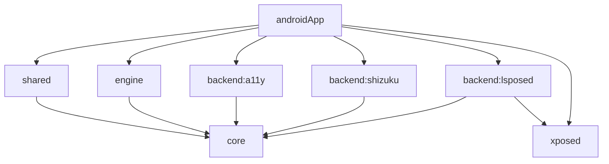

# GazeKeep 可维护性分析与重构提案

分析日期：2026-10-08。源码基线：`f32143560743`（main）。

状态：**2026-10-08 已采纳并完成代码结构重构，实机回归待执行**。本文保留重构前的分析和目标，当前源码入口见[维护导航](../../maintenance/维护导航.md)，实施与验证见[重构验证](../../testing/maintainability-refactor.md)。采纳的设计决议已写入架构设计 §0、§2、§12。产品范围与安全要求仍以规划文档和架构设计为准。

## 1. 结论

现有八个 Gradle 模块的主要边界合理：纯逻辑、Android 检测、UI、三个后端、system_server 钩子和应用装配已经分离。可持续维护的主要障碍是模块内部仍按里程碑堆叠实现，入口文件承担过多职责，文档混合了当前实现与目标能力。

建议保留现有模块，先删除无入口的历史实现，再按功能目录和资源生命周期拆组件。唯一优先考虑新增的模块是 LSPosed 桥接协议，用构建依赖强制隔离 App 与钩子实现。暂不将每个页面拆成 Gradle 模块，也不转换 KMP、不引入 DI 或导航框架。

人工审核的目标：修改一个设置页面只需阅读该页面和对应状态/命令；修改检测策略只需阅读 core 策略及测试；修改后端不必阅读 UI；审核资源释放可以从一个明确的运行会话入口追到所有清理动作。

## 2. 当前目录与依赖

统计只计 `src` 下 Kotlin 文件；生产源码包含 commonMain/androidMain/main，测试按测试源集统计。行数包含注释和空行，不作为拆分的硬阈值。

| 模块 | 生产文件 / 行数 | 测试文件 | 实际职责 |
|---|---:|---:|---|
| androidApp | 9 / 1,259 | 1 | Activity、平台操作、控制器、前台服务、后端选择、图标缓存 |
| shared | 8 / 1,239 | 2 | miuix 页面与 UI 接口，夹杂模板和历史接口 |
| core | 11 / 735 | 4 | 类型、reducer、门控、投票与保亮策略 |
| engine | 11 / 683 | 1 | 相机、分类、采集会话、门控采样、空闲时钟、配置、全局运行状态 |
| backend:a11y | 1 / 200 | 0 | 无障碍服务与 overlay 保亮实现 |
| backend:shizuku | 6 / 547 | 2 | App 侧后端、shell 服务、手写 Binder 协议、电源解析、超时恢复 |
| backend:lsposed | 1 / 151 | 0 | App 侧桥接探测、注册、保亮和 Binder 解析 |
| xposed | 9 / 566 | 4 | 钩子入口、签名解析、安全门控、system_server 核心和协议 |

实际 Gradle 项目依赖如下，`api` 还会把依赖暴露给消费者：



`shared`、`engine` 与三个后端通过 `api(project(":core"))` 暴露 core；`backend:lsposed` 通过 `api(project(":xposed"))` 暴露整个钩子模块。后者在源码中只使用 protocol 包，但 Gradle 没有强制限制。

与设计目录的差异：没有 `hidden-api` 模块，没有 AppGraph、独立副作用执行器和 DecisionLog 组件；不能把设计图中的这些名称当成已经存在的实现。

## 3. 人工阅读主链路

推荐首次阅读顺序：

1. `MainActivity` → `AndroidGazeKeepController`：UI 状态、设置保存、自检入口。
2. `ConfigStore` → `EngineActivation` → `GazeService`：读取配置、启停与装配。
3. `BackendSelector` → 三种后端与 oracle：确定后端和 deadline 来源。
4. `GazeEngine` → `EngineReducer`：所有决策事件串行归约为副作用。
5. `GazeService.runEffect` → `M0CaptureSession` → `CameraXFrameSource` / `MlKitFrameClassifier`：门控、采帧、分类、投票、执行保亮。
6. `core/commonTest` 和 `xposed/src/test`：安全不变量；`docs/testing`：设备验收依据。

注意：`GazeEngine` 串行处理事件，但 `runEffect` 会启动异步任务。reducer 测试通过不等于 Android 副作用生命周期和回调顺序已经验证。重构必须保持任务归属、取消、结果回灌及后端切换顺序。

## 4. 精简清单

### 4.1 可删除候选：已查源码引用，仍需编译确认

| 候选 | 证据 | 处理 |
|---|---|---|
| `AndroidM0DebugController`、`AndroidM1EngineController`、`AndroidM2ShizukuController` | 当前 MainActivity 只构造 AndroidGazeKeepController；全仓 Kotlin 引用仅在这些类自身和旧接口之间 | 成组删除，消除旧 SharedPreferences 配置写入和重复启停逻辑 |
| `ui/M0DebugController.kt`、`ui/M2ShizukuController.kt` | 只服务上述旧实现；M1 接口也混在 M0 文件内 | 随旧控制器删除 |
| `Greeting.kt`、`GreetingUtil.kt`、`Platform.kt`、`Platform.android.kt` | 形成独立的模板调用链，产品入口不使用 | 删除模板链 |
| `compose-multiplatform.xml` | 当前 Kotlin 页面未发现对应资源引用 | 检查所有资源/XML 引用及生成资源编译后删除 |
| shared 两个 `assertEquals(3, 1 + 2)` 测试 | 不验证任何产品行为 | 删除，不用这类测试证明 UI 安全；提取导航逻辑有需要时再加入行为测试 |
| GazeService 的 `PREFS_NAME`、`KEY_ENABLED`、`KEY_M1_TEST`、`KEY_BACKEND_LOCK` | 只剩常量声明，配置读取已走 DataStore | 删除旧常量 |
| 未引用版本目录项、unused import、旧调试字符串、ProGuard 模板注释 | 需逐项对照构建脚本与全仓引用 | 单独清理提交，不升级依赖、不同时开启 R8 |

“无引用”按仓库静态搜索判定，不等于经过 APK、反射和实机验证。Manifest、assets、META-INF、AIDL、keep 规则中的类名也必须检查。

### 4.2 应保留或改名，不能当作冗余删除

- `M0CaptureSession` / `M0CaptureResult`：正式服务与自检正在共用。改为 `AttentionCaptureSession` / `AttentionCaptureResult`，放入 `engine/capture`，保持算法、帧数、时限和 Analyzer 生命周期不变。
- `LegacyMigration`：仍承担已安装版本的配置升级；“旧配置”不代表“无用代码”。与旧控制器区别对待。
- `PendingTimeoutRestoreStore`：保存恢复系统超时所需的事务状态，独立存储有安全用途，不能为了“只保留一个存储”并入普通设置或删除。其落盘时序应另外审核，不与目录移动混改。
- `ModernEntry`：LegacyEntry 正在调用；它实际是框架无关安装入口，当前没有真正 libxposed 入口适配。可改内部名称为 `HookBootstrap`；外部入口类名保持兼容，META-INF 的现代声明另行核实。
- 无障碍 Pulse/Hold：架构 §0 明确保留 Pulse 供其他 ROM 验证。本轮精简不改变后端策略。
- `FrameSource`、`FrameClassifier`、`KeepAwakeBackend`、`TimeoutOracle`：是跨实现边界，保留；不因只有一个当前实现而删除接口。
- core/shared 的 KMP 构建：只有 Android target 是已知设计取舍。删除 Greeting 模板即可，不把构建体系转换夹在目录重构里。

### 4.3 尚未兑现的能力应列为功能债务

这些内容不是死代码，不能靠删除字段或改文档描述完成验收：

- `AndroidGateProbe` 的 proximity、lux、faceDown 固定为 null；相机检查只验证有无前摄，未检测占用。需要逐项实现或明确当前限制。
- 前台应用采样接入 `GazeA11yService.current?.foregroundPackage`；LSPosed deadline 有包名字段，但门控采样未直接使用它。没有无障碍来源时的白名单行为需要针对三个后端验证。
- `GazeConfig` 有 classifier/MediaPipe、低电量暂停、调试日志等字段；ConfigStore 只持久化当前七项运行设置及自检时间，不能把全部模型字段当成可用用户设置。MediaPipe 在规划中属于后续范围，移除占位配置需先修订设计。
- `EngineEffect.Record` 目前只发布最后判定，没有设计要求的最近 50 条缓冲和 24 小时日志文件机制。
- README 曾停留在 M0；架构 §2 还混有模板 minSdk 24、未建 hidden-api、规划中的组件；发布构建尚未开启 R8。要在文档中区分现状、目标与待验证能力。

## 5. 目标目录与组件

下面为源码包内目录，省略 sourceSet 与 `cn/rainafter/app/gazekeep` 前缀。文件名称是建议，不代表现有实现。

```text
androidApp/
  app/                  MainActivity、AppGraph（手写装配）
  controller/           AndroidGazeKeepController、BackendReadinessProbe
  selftest/             SelfTestCoordinator（步骤、任务与预览绑定）
  applist/              LaunchableAppsRepository、AppIconCache
  platform/             AndroidPlatformActions
  runtime/              ServiceActivation、BackendSession、BackendSelector、RuntimeStatusStore
  service/              GazeService（Android 生命周期适配）
  notification/         GazeNotifier（渠道、文案、限频）
shared/commonMain/
  ui/App.kt             状态订阅、主题与路由装配
  ui/contract/          GazeKeepController、PlatformActions、状态模型
  ui/navigation/        SettingsScreen、回退栈与转场
  ui/screens/           Home、Backend、Detection、Scope、Apps、Protection、Privacy、SelfTest
  ui/components/        分组标题、提示卡、通用 Scaffold
  ui/text/              attention/backend/readiness 的资源映射
core/commonMain/core/
  model/                Attention、Config、Readiness 等值类型
  backend/              后端与 deadline 契约
  engine/               State、Event、Effect、Snapshot、DecisionRecord、Reducer
  policy/               注视、门控、保亮、降亮与自检纯逻辑
engine/
  runtime/              GazeEngine、EngineEffectRunner 的具体执行器
  capture/              AttentionCaptureSession、CaptureResult
  camera/               帧源与短生命周期相机
  classify/             分类器与亮度采样
  gate/                 GateProbe、AndroidGateProbe、ForegroundAppSource
  oracle/               IdleClockOracle
  config/               ConfigStore、LegacyMigration
backend/a11y/           GazeA11yService、A11yKeepAwakeBackend（先分文件）
backend/shizuku/         ShellService、client/、protocol/、oracle/、restore/
backend/lsposed/         LsposedKeepAwakeBackend、SystemPowerBinderResolver
xposed/                 entry/、hook/、power/（保留当前安全隔离）
bridge/protocol/         BridgeProtocol、IGazeKeepClient.aidl（后续独立模块）
```

目录职责比数量重要：UI 页面采用功能目录；core/engine 按执行链路分目录；backend 按机制分模块。只被一个页面使用的小组件留在页面旁边，避免全局 components 变成杂物箱。不要创建没有实际职责的 util、manager、base 层。

### 5.1 拆分职责与资源归属

| 组件 | 唯一职责 | 资源与边界 |
|---|---|---|
| AppGraph | 在应用装配层提供依赖与工厂 | 不含策略，不持有裸帧；分别创建服务会话与自检会话 |
| AndroidGazeKeepController | 将配置、运行状态和操作结果映射成 UI 状态 | 不直接管理相机或后端注册；保留现有 UI 门面接口 |
| SelfTestCoordinator | 管理自检步骤、取消与通过标记 | 独占短时相机，停止引擎后才采集，停止/离页即释放 |
| ServiceActivation | 根据已保存配置安排启停 | 应用生命周期任务；替换文件私有 EngineActivation，关闭可取消待启动任务 |
| BackendSession | 装配选择的后端、oracle 与订阅 | 服务会话生命周期；切换期间先撤销保亮能力，释放旧资源，再接入新 deadline |
| EngineEffectRunner 实现 | 将 effect 执行结果回灌为 EngineEvent | 放 engine，仅通过注入的接口/函数使用后端、通知与记录；不得 import backend 实现或 GazeService |
| RuntimeStatusStore | 发布服务/reducer 派生状态 | 放 androidApp，替换 engine 中应用级单例；UI 不能用它绕过 reducer |
| GazeNotifier | 发通知并按同类 10 分钟限频 | 中文文案放 Android strings；不向 shared 引入 Android 通知类型 |
| LaunchableAppsRepository / AppIconCache | 获取启动器列表与图标缓存 | 保持 MAIN/LAUNCHER 查询和取消行为，不扩大权限 |

保持手写装配；现有 GazeKeepController / PlatformActions 已是清楚的 UI 边界，不先拆成大量接口。只有确实需要替换实现、隔离依赖或测试外部副作用时才新增接口。资源拥有者必须有明确的 close/stop，不让多个组件同时取消同一个任务。

### 5.2 核心状态机与后端

`EngineModel.kt` 同时放状态、事件、副作用、记录与 reducer（356 行）。先按上述概念分文件，保持一个 reducer 入口，不引入动态 handler 注册或多态状态模式。拆文件不改事件名称或转移语义，方便审核者逐项对照架构 §4。

无障碍先将服务与执行后端分文件；Shizuku 保持单模块，用目录显式标出 App 与 shell 代码，手写 Binder 协议不在这轮改为 AIDL。LSPosed 的 Binder resolver 可独立文件，钩子签名、安全校验与电源逻辑保留当前分层。

### 5.3 真正值得增加的模块边界

建议独立 `:bridge:protocol`，仅包含常量与 AIDL，不依赖 core、协程、相机或 UI：

```text
backend:lsposed ──▶ bridge:protocol ◀── xposed
androidApp ──▶ backend:lsposed
androidApp ──▶ xposed（负责把入口打入唯一 APK）
```

这能把“App 只用 protocol 包”的约定变成构建约束。保留原协议包名、descriptor、transaction 编号、协议版本和 AIDL 字段顺序；不为了目录变化让旧 system_server 与新 App 协议不兼容。

新增模块要同步调整 AIDL 生成、入口打包和 keep 规则，并构建 APK 验证。core 仍不依赖 Android；system_server 侧依赖树不能引入协程、DataStore 或 Compose。普通 `api(core)` 是否改成 implementation，要根据 public API 中是否暴露 core 类型逐项判断，不一刀切。

## 6. 面向人工审核的实施顺序

每一批必须可以独立编译、审核、回退。纯移动使用 `git mv`，不混入格式化、依赖升级、算法调整。下表是变更批次，不要求现在创建分支或 PR。

| 批次 | 范围 | 审核重点 / 完成条件 |
|---|---|---|
| 0：现状基线 | README、本文、设计中的现状标记 | 对齐 M4 状态，列清功能债务；采纳方案写入架构决议 |
| 1：删除残留 | 旧控制器/接口、Greeting 链、模板资源/测试、无用常量 | 全仓含资源的引用检查；APK 构建及 lint；设置仍只经 DataStore 修改 |
| 2：UI 目录化 | 8 页面、路由、少量复用组件与资源映射 | 保持页面行为与文案；回退、旋转恢复、搜索/勾选、自检离页取消实机回归 |
| 3：核心与采集命名 | EngineModel 分文件、M0CaptureSession 改名、a11y 分文件 | 核心不变量全部通过；算法/阈值、外部入口和协议不变 |
| 4：控制器组件化 | 自检、应用列表、就绪探测、启停与运行状态 | 冷启动配置回读、关闭取消待启动、自检相机独占；关注 Activity/应用生命周期分离 |
| 5：运行会话组件化 | GazeService 薄化、BackendSession、副作用执行器、Notifier | 切换/掉线/触摸/息屏时取消与释放；Shizuku 恢复系统设置；结果始终回灌 reducer |
| 6：协议模块隔离 | bridge:protocol、依赖与 AIDL/打包 | 协议版本不变；App 不引用 hook/core 实现；system_server 安全测试与实机重启 |
| 7：维护入口收口 | README 阅读地图、测试矩阵与必要的静态边界检查 | 每条主链路都有入口、负责组件和验证位置；构建/依赖文档与实际一致 |

批次 5 的异步回调关联、异常回灌、切换完成等待，是高风险审核点。若发现实际缺陷，单独提交修复及行为测试，不用“移动文件”掩盖行为变化。逐步用 BackendSession 的事件订阅替代 `GazeA11yService.current` 与全局可变回调；不一次引入全局事件总线。

构建脚本目前有 SDK/JVM 配置重复，但模块仅八个且脚本较短。暂不增加 build-logic；日后确需集中配置时，用一个小的约定插件，保留 application、KMP、普通 library 的差异。

## 7. 验证与审核标准

实施代码变更前运行一次基线，失败区分既有问题与此次引入；记录实际命令、结果和设备条件，不把历史实测当作本轮回归。

```bash
./gradlew :androidApp:assembleDebug
./gradlew :core:allTests :shared:testAndroidHostTest
./gradlew :engine:testDebugUnitTest :backend:shizuku:testDebugUnitTest
./gradlew :xposed:testDebugUnitTest :androidApp:testDebugUnitTest
./gradlew :androidApp:lintDebug
```

以上任务来自仓库约定和 Android 模块命名，实施时以实际 Gradle 任务清单确认。纯文档修改不需要执行 APK 构建。删除 shared 模板测试后，明确报告该源集没有行为测试，而不是把无测试当作新增验证通过。

必须保留 Unknown 不 Extend、触摸取消采帧、上限后 Yield、ScreenOff 释放、多人非 Looking、切换期间不 Extend、过期 seq 为 STALE 的全部测试。运行会话提取若改变副作用组织，要加入有意义的取消/掉线/旧结果回灌测试，不写只镜像实现的测试。

设备回归按批次范围执行：UI 批次检查导航与自检；运行会话/协议批次检查三种后端的正视、转头、相机占用、触摸、息屏、掉线、重启和默认熄屏。保持 `canRetrieveWindowContent=false`，审核 Manifest 合并后的权限与入口打包。分类器或阈值变化单独重跑 M0 计数表。

人工验收问题：

- 修改一项功能，能否从目录名直接定位到入口、实现和测试？
- 一个组件的创建者、任务 scope、取消与关闭是否能在同一条链路看清？
- 是否只通过 reducer 决策，异步结果是否有清楚的归属和失败路径？
- 是否保留所有安全不变量、协议兼容和隐私承诺？
- 文档是否明确区分已实现、已实测、待验证和后续规划？

## 8. 首轮分析的边界（历史记录）

本轮完成了生产目录、构建依赖、当前入口、核心 reducer、服务副作用、三种后端接线、配置/迁移及测试源码的静态分析；使用知识图谱确认当前提交，架构社区结果为空，因此目录与依赖结论以源码和构建脚本为依据。

首次分析时仅新增分析提案并修正 README 的过期描述，没有移动或删除生产代码，没有运行构建、自动测试或新增实机验证。本文的删除项是执行候选，目录与组件是目标结构，功能债务也未在本轮解决。
